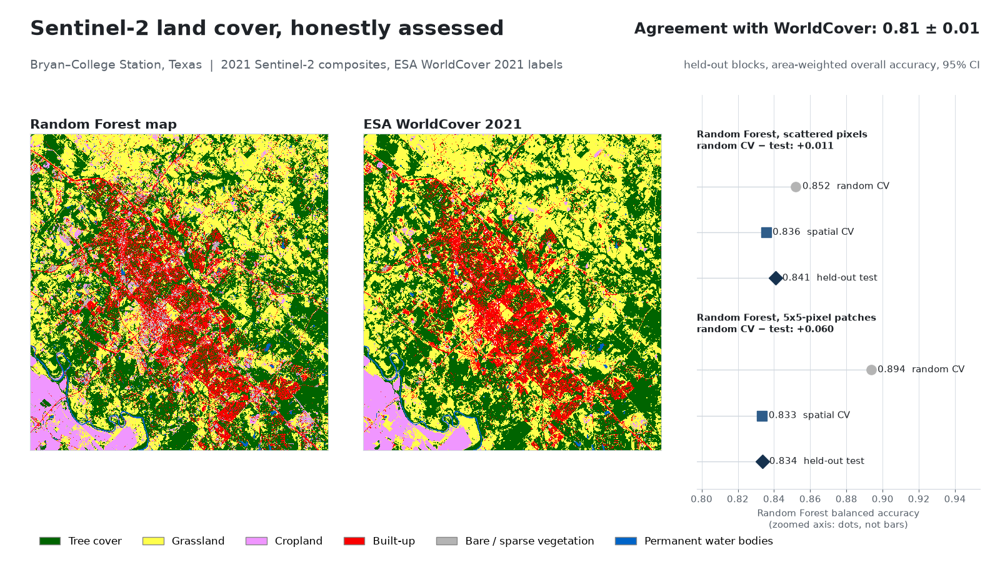
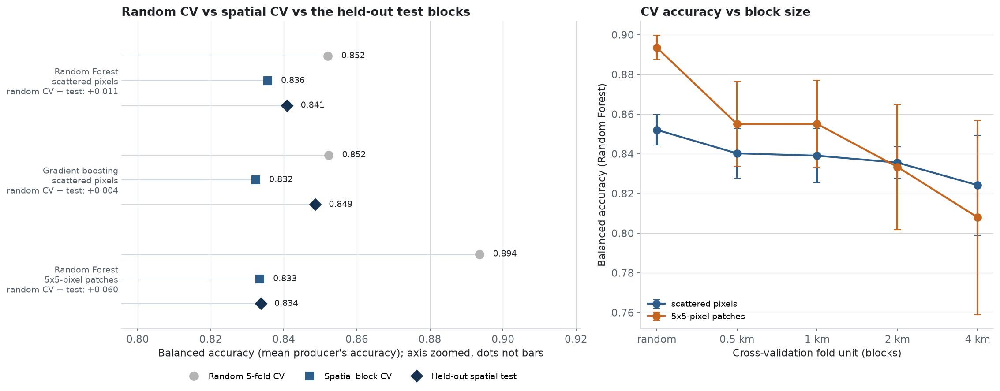
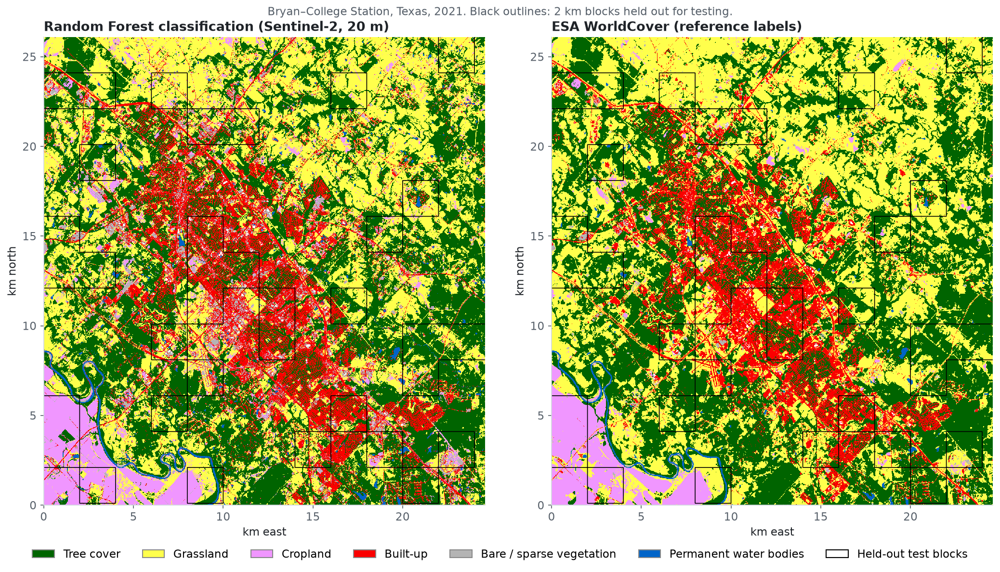
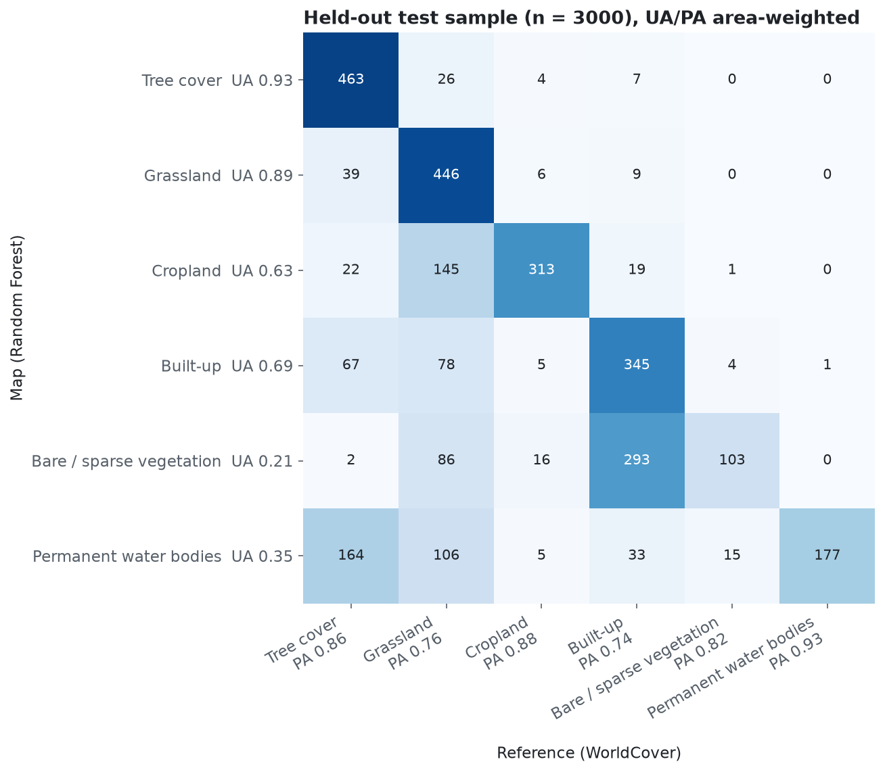
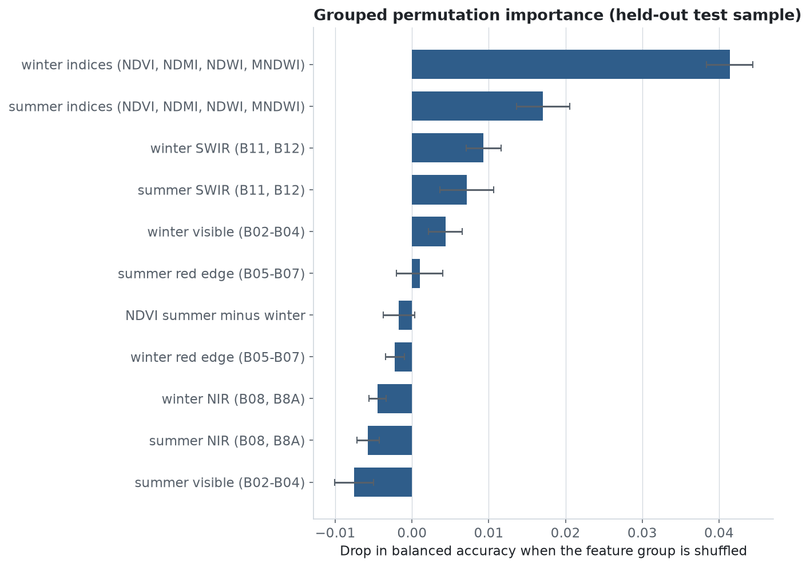

# Sentinel-2 land-cover classification with honest accuracy assessment

A Random Forest maps land cover around Bryan–College Station, Texas, from 2021 Sentinel-2 imagery. The point of the project is the accuracy assessment: how much random cross-validation overstates accuracy compared with spatial validation, and what the map's accuracy and class areas really are when estimated with the Olofsson et al. (2014) good-practice method.



## Results

All numbers come from one run (`python run.py`, seed 42). They are written to [`results/metrics.json`](results/metrics.json).

**Study area:** -96.45 to -96.20 °E, 30.52 to 30.75 °N (Brazos County, about 24.6 × 26.1 km), UTM 14N, 20 m pixels (1305 × 1230).
**Classes (ESA WorldCover 2021):** tree cover, grassland, cropland, built-up, bare/sparse vegetation and permanent water. Herbaceous wetland (0.002 % of the area) was dropped. No shrubland, mangrove or moss classes occur here.

### Random vs spatial validation

Balanced accuracy (the mean of producer's accuracies) is used for this comparison. The CV samples are class-balanced and the test blocks are not, and balanced accuracy is the one metric that compares fairly across the two.

| Model | Training sample | Random 5-fold CV | Spatial block CV (2 km) | Held-out spatial test |
|---|---|---|---|---|
| Random Forest | 12,000 scattered pixels | 0.852 | 0.836 | 0.841 |
| Gradient boosting (baseline) | 12,000 scattered pixels | 0.852 | 0.832 | 0.849 |
| Random Forest | 12,026 pixels in 779 patches of 5 × 5 | **0.894** | 0.833 | **0.834** |

- **The sampling design decides how much random CV inflates accuracy.** With scattered single pixels (about 1 % of the training area), few sampled pixels have a sampled neighbour, so random folds rarely put near-duplicates on both sides of a split, and random CV is only about 1.6 points above spatial CV. When the same number of pixels comes as polygon-like 5 × 5 patches, the way training data are often digitized, random CV reports 0.894. The model then scores 0.834 on the held-out blocks, so random CV overstates accuracy by 6 points. Spatial block CV, with each patch kept whole in one fold, gives 0.833, almost exactly the held-out score.
- As the CV blocks grow (0.5, 1, 2 and 4 km), the patch-sample estimate falls from 0.855 to 0.808 ([figure](figures/cv_comparison.png)). This is the pattern Roberts et al. (2017) and Ploton et al. (2020) describe.
- Random Forest and gradient boosting perform about the same. Gradient boosting scores slightly higher on the held-out blocks.

### Map accuracy (agreement with WorldCover) on the held-out blocks (Random Forest)

Here 36 randomly chosen 2 km blocks (140.6 km²) were held out, and training pixels within 200 m of them were removed. Accuracy was estimated from a stratified random sample of 500 pixels per mapped class (n = 3,000) using the Olofsson et al. (2014) estimators. The census row compares every test pixel, which is possible because WorldCover covers them all.

| | Overall accuracy | Kappa* | Macro F1 |
|---|---|---|---|
| Olofsson stratified estimate | **0.806 ± 0.015** (95 % CI) | | |
| Census of all test-block pixels | 0.807 | 0.731 | 0.680 |
| Census, gradient boosting baseline | 0.817 | 0.743 | 0.696 |

\*Kappa is shown only for comparison with older studies; Pontius & Millones (2011) explain why it should not be used to judge accuracy.

| Class | User's acc. (± 95 % CI) | Producer's acc. (± 95 % CI) | Mapped area km² | Estimated area km² (± 95 % CI) | WorldCover census km² |
|---|---|---|---|---|---|
| Tree cover | 0.93 ± 0.02 | 0.86 ± 0.02 | 50.55 | 54.61 ± 1.72 | 54.08 |
| Grassland | 0.89 ± 0.03 | 0.76 ± 0.02 | 43.39 | 50.89 ± 1.83 | 50.52 |
| Cropland | 0.63 ± 0.04 | 0.88 ± 0.05 | 15.59 | 11.13 ± 0.90 | 11.92 |
| Built-up | 0.69 ± 0.04 | 0.74 ± 0.03 | 23.54 | 21.88 ± 1.25 | 21.89 |
| Bare / sparse vegetation | 0.21 ± 0.04 | 0.82 ± 0.11 | 5.88 | 1.48 ± 0.29 | 1.56 |
| Permanent water | 0.35 ± 0.04 | 0.93 ± 0.13 | 1.66 | 0.64 ± 0.12 | 0.65 |

- **The area estimator works.** The map overstates bare ground about fourfold (5.88 vs 1.48 km²) and water by about 2.5 times, because the model was trained on equal numbers of pixels per class and so over-predicts rare classes. The sample-based Olofsson estimates correct this. **All six 95 % intervals contain the census WorldCover area**, a check on the estimator that real projects rarely get to make.
- Most of the confusion is grassland mapped as cropland, and built-up pixels mapped as bare ground (construction sites, gravel lots and roofs). The water class is also over-predicted: about a third of the pixels mapped as water are tree cover in WorldCover (164 of 500 sampled), likely shaded riparian forest and dark canopy. See the [confusion matrix](figures/confusion_matrix.png).
- The winter (December–February) composite matters most. Shuffling the winter spectral indices costs 4.1 points of balanced accuracy, more than any other feature group ([grouped permutation importance](figures/feature_importance.png)). Winter is plausibly when evergreen and deciduous trees, dormant pasture and fallow fields differ most.

<p float="left">
  
</p>
<p float="left">
  
</p>
<p float="left">
  
  
</p>

## Method

1. **Imagery.** Sentinel-2 L2A scenes come from the Microsoft Planetary Computer STAC API. The 12 least-cloudy items (scene cloud cover under 10 %) were used for each of two windows: summer (Apr–Sep 2021) and winter (Dec 2020–Feb 2021). The tiles are 14RQU and 14RQV. Scene IDs are listed in `metrics.json`. Pixels are loaded at 20 m with `odc-stac` (10 m bands averaged), and only Scene Classification Layer classes 2, 4, 5, 6 and 7 are kept (clouds, cloud shadow, cirrus and snow are removed). A per-pixel median gives each season's composite. The processing-baseline 04.00 reflectance offset is handled, although none of the 2020–2021 scenes need it.
2. **Features (29).** For each season: B2, B3, B4, B5, B6, B7, B8, B8A, B11 and B12, plus NDVI, NDMI (B8A/B11), NDWI (B3/B8) and MNDWI (B3/B11). The 29th feature is the summer-minus-winter NDVI amplitude.
3. **Labels.** ESA WorldCover 2021 (v200) is resampled to the 20 m grid by majority (mode). Classes covering less than 0.5 % of the area are merged into a similar class (shrub into grassland, for example) or dropped if none fits. Only herbaceous wetland was dropped here.
4. **Spatial split.** The grid is cut into 2 km blocks. A seeded random 20 % of blocks are held out as the test area, and training pixels within 200 m of a test block are removed so that neighbouring pixels cannot leak across the edge.
5. **Training samples.** 2,000 pixels per class are drawn from the training blocks in two designs: *scattered* (stratified random pixels) and *clustered* (5 × 5-pixel patches, like digitized polygons). The final map uses the scattered sample.
6. **Models.** Random Forest (300 trees; Breiman 2001) and scikit-learn's `HistGradientBoostingClassifier` (300 iterations) as the baseline.
7. **Validation.** Random `KFold` and block-grouped `GroupKFold` (5 folds each) are run on each training design. A patch is grouped by the block of its seed pixel, so a patch that straddles a block edge is never split across folds. The Random Forest is also run with blocks of 0.5, 1, 2 and 4 km. The final check is on the held-out test blocks. `--cv-buffer-m` optionally drops training samples within a set distance of the held-out fold. It is off by default and was not used for the numbers above.
8. **Accuracy and area.** The test sample is drawn by map class (stratified random, 500 per stratum). Overall, user's and producer's accuracy and class areas are estimated with 95 % confidence intervals using Olofsson et al. (2014), with Card (1982) for the producer's-accuracy variance. The estimator is unit-tested against the worked example in that paper.
9. **Feature importance.** Grouped permutation importance is measured on the held-out sample. Correlated features (for example all winter SWIR bands) are shuffled together, because shuffling one correlated feature at a time gives importances near zero.

## How to run

```bash
conda env create -f environment.yml
conda activate gis-portfolio
python run.py                                    # default study area, about 3 minutes on first run
python run.py --bbox -97.85 30.20 -97.60 30.45   # any other ~25 km box (UTM zone picked automatically)
python run.py --help                             # year, resolution, seed, block size, buffer, sample sizes, ...
pytest                                           # 10 fast offline tests
```

No account or API key is needed. The first run reads only the needed windows of the cloud-optimized GeoTIFFs and caches the feature stack, WorldCover labels and the classified map as GeoTIFFs in `data/` (not tracked by git). The cached files open directly in QGIS or ArcGIS Pro. Reruns take about 2 minutes. The measured end-to-end time of a first run was 170 s (82 s of it data loading) on a Windows PC with 24 logical CPUs. Data loading runs in a separate process, because on Windows, GDAL network reads were seen to stall later thread pools in the same process.

```
landcover/
  data.py      STAC search, cloud-masked median composites, WorldCover, GeoTIFF cache
  features.py  spectral indices and the feature stack
  train.py     label harmonisation, spatial blocks, sampling designs, models, CV
  assess.py    error matrices, Olofsson et al. (2014) estimators, grouped permutation importance
  plots.py     figures (WorldCover's official class colors)
run.py         command-line entry point that writes figures/ and results/metrics.json
tests/         unit tests, including the Olofsson et al. (2014) worked example
```

## Limitations

- **This measures agreement with WorldCover, not ground truth.** WorldCover is itself a classified map. Its reported global overall accuracy is about 74 % for the 2020 v100 map and 77 % for the 2021 v200 map (Zanaga et al. 2021, 2022), and grassland/cropland and bare/built-up confusion are among its known weaknesses. "Accuracy" here means how well a 20 m Sentinel-2 model reproduces a 10 m WorldCover label. A real assessment would use reference labels interpreted from high-resolution imagery for each sample point.
- WorldCover is resampled from 10 m to 20 m by majority vote, so mixed pixels (roads, field edges, tree-lined streets) carry label noise.
- The equal-allocation training sample over-predicts rare classes (bare ground, water). The Olofsson area estimates correct the areas but not the map. Proportional allocation or class-weight calibration would improve the map itself.
- The 2 km block size was chosen, not fitted to a variogram. Results for 0.5–4 km are reported to show how sensitive they are. Wadoux et al. (2021) argue that a probability sample, like the stratified test sample used here, is the proper basis for map accuracy. Spatial CV is used here as a model-selection check, not as the accuracy statement.
- The study covers one area and one year, with a single seeded train/test split. Confidence intervals reflect sampling within that split, not variation between splits.

## References

- Breiman, L. (2001). Random forests. *Machine Learning*, 45, 5–32. https://doi.org/10.1023/A:1010933404324
- Card, D. H. (1982). Using known map category marginal frequencies to improve estimates of thematic map accuracy. *Photogrammetric Engineering and Remote Sensing*, 48(3), 431–439.
- Gao, B.-C. (1996). NDWI—A normalized difference water index for remote sensing of vegetation liquid water from space. *Remote Sensing of Environment*, 58(3), 257–266.
- McFeeters, S. K. (1996). The use of the Normalized Difference Water Index (NDWI) in the delineation of open water features. *International Journal of Remote Sensing*, 17(7), 1425–1432.
- Olofsson, P., Foody, G. M., Herold, M., Stehman, S. V., Woodcock, C. E., & Wulder, M. A. (2014). Good practices for estimating area and assessing accuracy of land change. *Remote Sensing of Environment*, 148, 42–57. https://doi.org/10.1016/j.rse.2014.02.015
- Ploton, P., Mortier, F., Réjou-Méchain, M., et al. (2020). Spatial validation reveals poor predictive performance of large-scale ecological mapping models. *Nature Communications*, 11, 4540. https://doi.org/10.1038/s41467-020-18321-y
- Pontius, R. G., Jr., & Millones, M. (2011). Death to Kappa: birth of quantity disagreement and allocation disagreement for accuracy assessment. *International Journal of Remote Sensing*, 32(15), 4407–4429. https://doi.org/10.1080/01431161.2011.552923
- Roberts, D. R., Bahn, V., Ciuti, S., et al. (2017). Cross-validation strategies for data with temporal, spatial, hierarchical, or phylogenetic structure. *Ecography*, 40(8), 913–929. https://doi.org/10.1111/ecog.02881
- Rouse, J. W., Haas, R. H., Schell, J. A., & Deering, D. W. (1974). Monitoring vegetation systems in the Great Plains with ERTS. *Third ERTS Symposium*, NASA SP-351, 309–317.
- Wadoux, A. M. J.-C., Heuvelink, G. B. M., de Bruin, S., & Brus, D. J. (2021). Spatial cross-validation is not the right way to evaluate map accuracy. *Ecological Modelling*, 457, 109692. https://doi.org/10.1016/j.ecolmodel.2021.109692
- Xu, H. (2006). Modification of normalised difference water index (NDWI) to enhance open water features in remotely sensed imagery. *International Journal of Remote Sensing*, 27(14), 3025–3033.
- Zanaga, D., Van De Kerchove, R., De Keersmaecker, W., et al. (2021). ESA WorldCover 10 m 2020 v100. Zenodo. https://doi.org/10.5281/zenodo.5571936
- Zanaga, D., Van De Kerchove, R., Daems, D., et al. (2022). ESA WorldCover 10 m 2021 v200. Zenodo. https://doi.org/10.5281/zenodo.7254221

## Data credits and licenses

- **Sentinel-2:** contains modified Copernicus Sentinel data (2020–2021), provided free and open under the Copernicus data policy (Legal Notice on the use of Copernicus Sentinel Data and Service Information).
- **ESA WorldCover 2021 v200:** © ESA WorldCover project 2021 / contains modified Copernicus Sentinel data (2021) processed by the ESA WorldCover consortium. Licensed under [CC BY 4.0](https://creativecommons.org/licenses/by/4.0/).
- **Data access:** [Microsoft Planetary Computer](https://planetarycomputer.microsoft.com/) STAC API and its Azure-hosted cloud-optimized GeoTIFFs.

Code is released under the [MIT License](LICENSE). © 2026 Landon Melesky.
